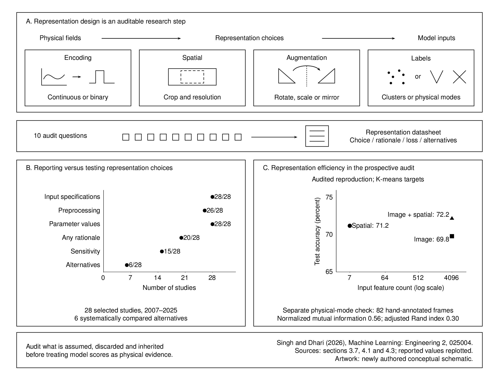

# Visual-mathematical literacy in applied machine learning

Representation choices determine what information a model receives and which
physical distinctions it can learn. This paper treats those choices as research
decisions that should be explained, tested and documented alongside the model.

[](figures/abstracts/assets/visualmath.svg)

[Editable figure and scientific source notes](figures/abstracts/README.md).

## Publication

**A framework for visual-mathematical literacy in applied machine learning:
why representation choices shape what models can learn**

Gaurav Singh and Rahul Singh Dhari. *Machine Learning: Engineering*, 2(2),
025004, published 27 July 2026.
[Read the publication](https://doi.org/10.1088/3049-4761/ae7df3).

Singh: Mathscapes Research, Bengaluru, India. Dhari: School of Civil and
Mechanical Engineering, Curtin University, Perth, Australia, as printed in
the published article.

### Published abstract

Machine learning (ML) is increasingly applied to physical and engineering systems, yet the translation of physical phenomena into model inputs has received limited systematic scrutiny. The upstream decisions that determine what the model can learn and how its outputs should be interpreted are typically treated as implementation details, but they embed inductive bias in the model. A review of 28 applied ML studies from materials, mechanics and computational materials science (2007–2025) found that all reported basic representation parameters, but only 21% systematically compared alternative representations; the pattern is indicative of a structural rather than merely incidental gap, with the transparency deficit persisting within the most mature and comparison-friendly class (CNN image pipelines). To address this gap, the paper introduces visual-mathematical literacy: a framework for reasoning about and evaluating representation choices, drawing on representation learning, inductive bias analysis, physics-informed ML, and design epistemology. A case study in auxetic metamaterial classification is developed in two phases: a retrospective analysis of six representation decisions across a three-stage pipeline, and a prospective audit executing each of the ten protocol questions end-to-end against a reproduction of the pipeline, showing which decisions the protocol corroborates, refines, and opens. The paper concludes with a protocol of ten audit questions paired with quantitative diagnostics.

## The framework

Visual-mathematical literacy makes the assumptions embedded in model inputs
explicit. Four categories form a cascade: encoding a physical field, choosing
its spatial domain and resolution, applying augmentation, and generating labels.
The paper pairs ten audit questions with quantitative diagnostics and a
representation datasheet recording the choice, rationale, information lost and
alternatives that were considered.

The framework supports retrospective diagnosis and prospective design. Its
scope is spatial or field-based physical-system representations. Graph and
spectral encodings need adapted questions; non-field tabular or time-series
problems are outside the demonstrated scope.

## Evidence and findings

A selected review of 28 studies from 2007–2025 documents a gap between describing
an input and testing the assumptions behind it. It is not a comprehensive review
of all applied machine learning.

| Reported practice | Studies, out of 28 |
| --- | ---: |
| Basic input specifications | 28 |
| Preprocessing steps | 26 |
| Numerical parameter values | 28 |
| At least partial rationale | 20 |
| Sensitivity analysis | 15 |
| Systematic comparison of representations | 6 (21%, rounded) |

The auxetic metamaterial case study has two phases. A retrospective analysis
examines six representation decisions in the earlier KNet1 pipeline. The paper
then reports a prospective audit against a deterministic reproduction, including
threshold/resolution sensitivity, alternative features and clustering algorithms,
augmentation ablations and independent hand annotation.

Reported examples from section 3.7 include:

- Thresholds 200–250 yield invariant binary encodings; at 280, full-pipeline
  test accuracy falls to 27% under that audit's setup.
- A seven-feature spatial summary reaches 71.2% test accuracy on K-means targets,
  compared with 69.8% for 4,096 image features and 72.2% for their combination.
- Against 82 independently hand-annotated frames, cluster/mode correspondence
  is partial: normalized mutual information is 0.56 and adjusted Rand index 0.30.
  Rare clusters are poorly represented in that small annotation sample.

These are published results, not experiments rerun here. The original KNet1
88.08% test result measures agreement with constructed cluster labels. It is a
different experimental result from the prospective audit scores above and does
not establish physical-mode accuracy. The single pipeline and the selected
literature sample do not establish cross-domain generality.

## Code and data availability

This companion contains a source-grounded summary and reproducible figure
sources. The small CSV files transcribe reported aggregate values; they are
neither simulation frames nor a new training dataset.

The original simulation/training pipeline, 82-frame annotations, per-question
audit artifacts and full review scoring sheets have not been recovered into
this companion. The publication refers to supplementary materials; consult its
[official data page](https://iopscience.iop.org/article/10.1088/3049-4761/ae7df3/data).
The data page was not readable through the automated access available during
preparation, so its files and reproduction instructions have not been verified.

The case study relates to the [AuxMech/KNet1 publication](https://doi.org/10.1177/20414196241281069).
The separate KNet2 partial recovery has different provenance and is not supplied
as this paper's reproduction dataset. No new HF dataset is created for this work.

PDFs, draft manuscripts and reviewer records are excluded. Use the publisher
link for the article. For figure rebuilding and maintainer setup, see
[contributing.md](contributing.md).

## Citation

```bibtex
@article{singh2026visualmathematical,
  author = {Singh, Gaurav and Dhari, Rahul Singh},
  title = {A framework for visual-mathematical literacy in applied machine learning: why representation choices shape what models can learn},
  journal = {Machine Learning: Engineering},
  year = {2026},
  volume = {2},
  number = {2},
  pages = {025004},
  doi = {10.1088/3049-4761/ae7df3}
}
```

The article is attributed to its authors and publisher. No publisher illustrations
or manuscript files are redistributed here; the graphical abstract is newly
authored. No new figure reuse licence is asserted.
